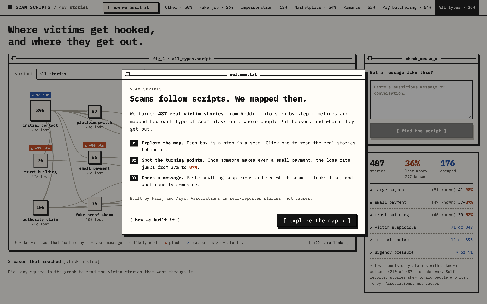
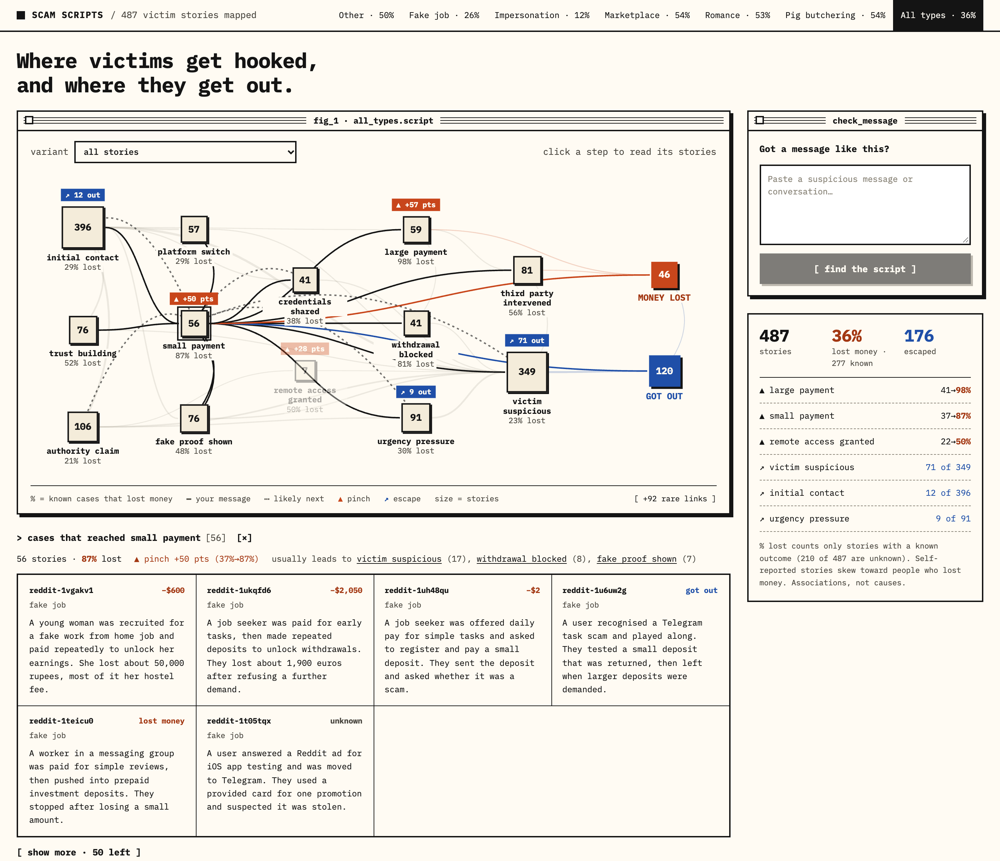
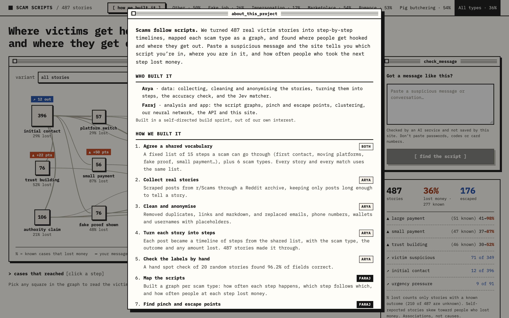
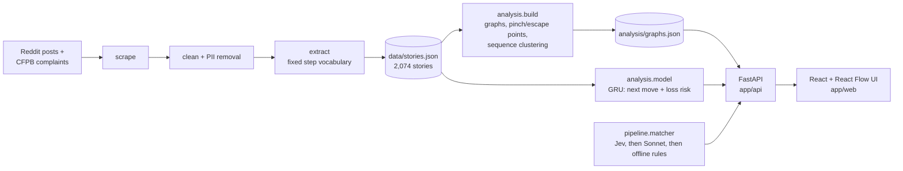

# Scam Scripts

**Scams follow scripts.** We turned 2,074 real victim stories from Reddit (r/Scams and nine other scam-related subreddits) and CFPB consumer complaints into step-by-step event sequences, mapped each scam type as a graph, and found where victims commit (pinch points) and where they get out (escape points). Paste a suspicious message and the site tells you which script you're in, which step you're at, what usually comes next, and how often people who took that step lost money. A small neural network we trained on the stories adds its own forecast of the scammer's next move.

**Live site: [scam-script-mapper.vercel.app](https://scam-script-mapper.vercel.app)**

Built by **Faraj** (analysis, model, API and site) and **Arya** (data pipeline and matcher). We built it in a self-directed build sprint, out of our own interest.


## What we found

From the current data (`data/stories.json` and `analysis/graphs.json`: 2,074 stories, 1,333 with a known outcome):

1. **Paying is the point of no return.** Once victims make even a small payment, the loss rate goes from **60% to 96%** (299 of 311 known). After a large payment it's **over 99%** (421 of 422). Stories with any payment step: 98% lost. Stories without one: 23%.
2. **People escape by getting suspicious before they pay.** "Victim suspicious" is the top escape point in every scam type. Victims who got suspicious before paying lost money **6%** of the time (30 of 469 known). Those who only got suspicious after paying lost **95%** of the time (183 of 192).
3. **The script matters more than the scam's name.** Clustering the event sequences gives script variants that cut across the scam-type labels (adjusted Rand index 0.03). The *third party steps in* variant (684 stories) spans all six types and loses 84%, while the *victim suspicious only* variant (1,192 stories) loses 37%.
4. **A neural network only just beats simple counting on this data.** Our GRU names the scammer's next move 42% of the time, against 41–42% for frequency tables by scam type, and a learning curve on the first 487 stories showed only small gains from more of the same data. Richer detail per step is what would change that (see [Our model](#our-model)).

These are **associations in self-reported data, not causes**. See [Caveats](#caveats).

## A look around

| | |
|---|---|
|  |  |
| **First visit:** a short welcome, then straight to the map. | **Click any step** to read the real stories behind it, with outcomes and amounts lost. |
|  |  |
| **Paste a message:** Jev reads it, the graph lights up the path, and the card shows the loss rate if they continue plus our model's forecast. | **[ how we built it ]** in the header explains the whole process and who did what. |

## How it works



| Stage | Where | What it does |
|---|---|---|
| Contract | [`contract/`](contract/README.md) | The shared schema: a fixed 15-step vocabulary, 6 scam types, the Story shape and the matcher output. Both halves of the project build against it. |
| Pipeline | [`pipeline/`](pipeline/README.md) | Collects posts from r/Scams, nine other subreddits and an archived CFPB complaints file, cleans and anonymises them, and extracts each one into a Story: a chronological list of steps, plus scam type, outcome and amount lost. |
| Analysis | [`analysis/`](analysis/README.md) | Builds a transition graph per scam type: node counts, loss rates, pinch points (the biggest loss-rate jump versus the steps leading in, with minimum support so small samples can't win), escape points (steps most often followed by the victim getting out), and sequence clustering (edit distance + agglomerative clustering) to find script variants. |
| Model | [`analysis/model/`](analysis/README.md) | A small GRU trained on the stories to predict the scammer's next move and the chance of losing money, evaluated against frequency baselines with 5-fold cross-validation. |
| Matcher | [`pipeline/matcher.py`](pipeline/README.md) | Jev (TypeSafe System One) answers one yes/no question per step plus the scam type and the scammer's next move; code turns that into a contract-valid result. Falls back to Sonnet, then regex rules. |
| API | [`app/api/`](app/README.md) | Serves graphs, stories and clusters. `POST /api/match` runs the matcher with a timeout, adds `loss_rate_if_continues` from the real graph, and adds our model's forecast. |
| UI | `app/web/` | React + React Flow + Tailwind. The script graph (size = stories, % = known cases that lost money), click-through to stories, a script-variant picker, the matcher card, and the welcome and how-we-built-it popups. |

## Our model

A GRU (about 6,000 parameters, a 28 KB file) reads the steps seen so far plus the scam type and predicts two things: the scammer's **next move** (one of 11 moves; reactions like "victim suspicious" are never targets) and the **chance the story ends with money lost**. Outcome steps are kept out of the inputs, and stories are split so the model is never tested on one it learned from.

5-fold cross-validation on the 2,054 usable stories, mean over folds:

| Model | Next move: top-1 | Next move: top-3 | Loss risk: AUC |
|---|---|---|---|
| Most common move / base rate | 16% | 44% | 0.50 |
| Markov table by scam type / logistic regression | 41% | 75% | 0.87 |
| **GRU (ours)** | **42%** | **74%** | **0.87** |

On next move it edges the per-type Markov table by 1.9 points of top-1 accuracy (± 1.1, paired by fold), and on loss risk it ties logistic regression. A learning curve run on the first 487 stories (25% → 100% of them) showed next-move accuracy flattening, at roughly 1–2 points per doubling of data; it has not been rerun on the full 2,074. With stories this short (median 3 steps) and steps as plain labels, a frequency table already captures most of what's predictable. Richer inputs per step (platform, payment method, amount, message text) plus more stories are the next step. Full results: [`analysis/findings.md`](analysis/findings.md).

An earlier version predicted the next step in the *story*. On the first 487 stories it mostly predicted "victim suspicious" (331 of 953 transitions), because people post when they get suspicious. Version 2 predicts the scammer's next move instead.

## Run it

Needs Python 3.12 and Node 20+. From the repo root:

```bash
python3 -m venv .venv
.venv/bin/pip install -r app/requirements.txt -r pipeline/requirements.txt -r analysis/requirements.txt
.venv/bin/python -m analysis.build
.venv/bin/uvicorn app.api.main:app --port 8000
```

In a second terminal:

```bash
cd app/web && npm install && npm run dev
```

Open http://localhost:5173. First-time visitors see a welcome popup; add `?welcome` to the URL to see it again.

The matcher tries **Jev** first, then Claude Sonnet, then offline rules. For live matching put the keys in a `.env` file at the repo root (it's gitignored):

```bash
TYPESAFE_API_KEY=...     # Jev, the main matcher
ANTHROPIC_API_KEY=...    # optional, Sonnet fallback
```

With no keys the offline rules answer, and the two demo messages in [`app/demo/`](app/demo/messages.md) have stored answers, so the demo still works with no network. The card shows where each answer came from (`jev · live`, `sonnet · live`, `cached`, `offline rules`). Repeat texts are served from the matcher's cache; delete `pipeline/.cache/matcher/` to force a fresh call. `analysis/requirements.txt` installs PyTorch for our model; without it the "our model" box is simply hidden.

Retrain the model and rerun its evaluation (a few seconds on a laptop):

```bash
.venv/bin/python -m analysis.model.train
.venv/bin/python -m analysis.model.learning_curve
```

Tests:

```bash
.venv/bin/python -m pytest analysis/tests app/api/tests pipeline/tests
```

## Demo

1. Open **All types**: 2,074 stories, 59% of known outcomes lost money.
2. Point at **small payment**: the loss rate jumps from 60% to 96% once victims pay anything.
3. Point at **victim suspicious**: 182 of the 346 explicit escapes happen right after it.
4. Pick a **variant** to show a script that cuts across scam types.
5. Paste [`app/demo/fake_job.txt`](app/demo/fake_job.txt) into the matcher: it names the scam, highlights the steps so far, flags the likely next step (98% of known fake job cases at that step lost money), and shows our model's forecast below.

## Caveats

- **Self-reported and skewed.** These are stories people chose to post on Reddit or file as CFPB complaints, which lean toward dramatic cases and people who lost money.
- **Many outcomes are unknown.** 741 of 2,074 stories (36%) don't say how they ended. Every loss rate leaves those out, so each one is shown with its "known" count.
- **Model-extracted, not hand-labelled.** Steps, scam types and outcomes come from extraction against the fixed vocabulary. No API key was available during the build, so there were no live Haiku calls: the first 487 stories used hand-assisted extraction, the next 300 were labelled by Gemini 3.8 Flash and Claude Sonnet 4.6, and the last 1,300 by Claude Haiku, all in the same `record_story` format ([details](pipeline/README.md#extraction)). A hand spot check of 20 of the first stories found **96.2%** of field checks correct (77 of 80), and a model review of 20 of the new stories also found 96.2% ([details](pipeline/README.md#accuracy)).
- **Some links are built in.** You can't lose money without paying something, and "victim suspicious" sits next to the outcome, so parts of findings 1 and 2 are partly circular. The useful signal is how rarely anyone got out after paying.
- **Some cuts are still thin.** Every scam type now has at least 218 stories (pig butchering 264, romance 297), but a single step inside one type can rest on a few dozen known outcomes, so each figure is shown with its known count. The headline numbers use all types.

## Repo layout

```
contract/        shared schema (vocabulary, Story, matcher output)
pipeline/        scrape, clean, extract, matcher                (Arya)
data/            stories.json, spot checks                      (Arya)
analysis/        graphs, pinch/escape points, clustering        (Faraj)
analysis/model/  GRU, baselines, evaluation, learning curve     (Faraj)
app/api/         FastAPI backend                                (Faraj)
app/web/         React + React Flow frontend                    (Faraj)
app/docs/        screenshots
PLAN.md          the original build plan
```
