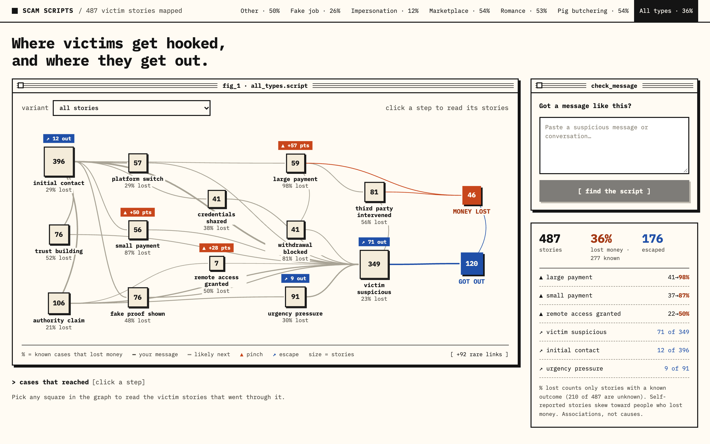
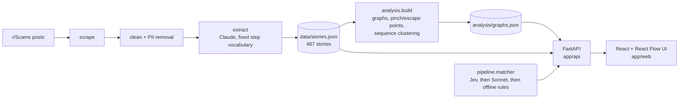
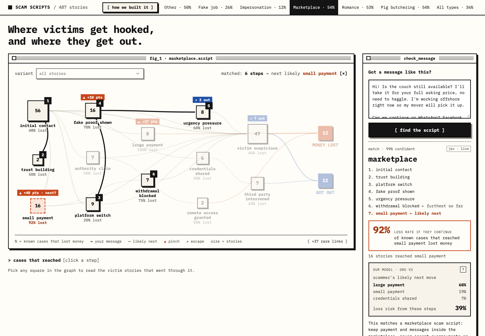

# Scam Scripts

**Scams follow scripts.** We turned 487 real victim stories from r/Scams into step-by-step event sequences, mapped each scam type as a graph, and found where victims commit (pinch points) and where they get out (escape points). Paste a suspicious message into the matcher and it tells you which script you're in, which step you're at, what usually comes next, and how often people who took that step lost money.



## What we found

From `analysis/findings.md` (487 stories, 277 with a known outcome):

1. **Paying is the point of no return.** Once victims make even a small payment, the loss rate goes from **37% to 87%** (41 of 47 known). After a large payment it's **98%** (50 of 51). Stories with any payment step: 92% lost. Stories without one: 10%.
2. **People escape by getting suspicious before they pay.** "Victim suspicious" is the top escape point in every scam type. Victims who got suspicious before paying lost money **5%** of the time (7 of 141 known). Those who only got suspicious after paying lost **89%** of the time (34 of 38).
3. **The script matters more than the scam's name.** Clustering the event sequences gives script variants that cut across the LLM's scam-type labels (adjusted Rand index 0.06). The largest, *builds trust → fake proof → third party steps in* (190 stories), spans all six types and loses 63%.

These are **associations in self-reported data, not causes**. See [Caveats](#caveats).

## How it works



| Stage | Where | What it does |
|---|---|---|
| Pipeline | [`pipeline/`](pipeline/README.md) | Scrapes r/Scams, cleans and anonymises posts, and extracts each one into a Story: a chronological list of steps from a fixed 15-step vocabulary, plus scam type, outcome and amount lost. |
| Contract | [`contract/`](contract/README.md) | The shared schema: step vocabulary, scam types, Story shape, matcher output. |
| Analysis | [`analysis/`](analysis/README.md) | Builds a transition graph per scam type: node counts, loss rates, pinch points (the biggest loss-rate jump versus the steps leading in, with a minimum support so small samples can't win), escape points (steps most often followed by the victim getting out), and sequence clustering (edit distance + agglomerative clustering) to find script variants. |
| Matcher | [`pipeline/matcher.py`](pipeline/README.md) | Jev answers one yes/no question per step plus the scam type and the scammer's next move, and code turns that into a contract-valid result. Falls back to Sonnet, then regex rules. |
| API | [`app/api/`](app/README.md) | Serves graphs, stories and clusters. `POST /api/match` runs the matcher with a timeout and adds `loss_rate_if_continues` from the real graph. |
| Model | [`analysis/model/`](analysis/README.md) | A small GRU we trained on the stories to predict the next step and the chance of losing money. Shown on the matcher card as "our model". In 5-fold cross-validation it ties simple frequency baselines (next step 54% vs 55%, loss AUC 0.85 vs 0.85); see [findings](analysis/findings.md). |
| UI | `app/web/` | The script graph (size = stories, % = known cases that lost money), click a step to read the stories behind it, script-variant picker, and the matcher. |

## Run it

Needs Python 3.12 and Node 20+. From the repo root:

```bash
python3 -m venv .venv
.venv/bin/pip install -r app/requirements.txt -r pipeline/requirements.txt -r analysis/requirements.txt
.venv/bin/python -m analysis.build
.venv/bin/uvicorn app.api.main:app --port 8000
```

In a second terminal:

```bash
cd app/web && npm install && npm run dev
```

Open http://localhost:5173. The matcher tries **Jev** (TypeSafe System One) first, then Claude Sonnet, then offline rules. For live matching put the keys in a `.env` file at the repo root (it's gitignored):

```bash
TYPESAFE_API_KEY=...     # Jev, the main matcher
ANTHROPIC_API_KEY=...    # optional, Sonnet fallback
```

With no keys the offline rules answer, and the two demo messages in [`app/demo/`](app/demo/messages.md) have stored answers, so the demo still works with no network. The result card shows where each answer came from (`jev · live`, `sonnet · live`, `cached`, `offline rules`).

Tests:

```bash
.venv/bin/python -m pytest analysis/tests app/api/tests pipeline/tests
```

## Demo

1. Open **All types**: 487 stories, 36% of known outcomes lost money.
2. Point at **small payment**: loss rate jumps from 37% to 87% once victims pay anything.
3. Point at **victim suspicious**: 71 of the 120 explicit escapes happen right after it.
4. Pick a **variant** to show a script that cuts across scam types.
5. Paste [`app/demo/crypto_mentor.txt`](app/demo/crypto_mentor.txt) into the matcher: it names the scam, highlights the steps so far, and flags the likely next step and its loss rate.



## Caveats

- **Self-reported and skewed.** These are stories people chose to post on Reddit, which leans toward dramatic cases and people who lost money.
- **Many outcomes are unknown.** 210 of 487 stories (43%) don't say how they ended. Every loss rate leaves those out, so each one is shown with its "known" count.
- **LLM-extracted, not hand-labelled.** Steps, scam types and outcomes come from model extraction against the fixed vocabulary. No API key was available during the build, so the current extraction cache was filled with hand-assisted extraction in the same `record_story` format rather than live Haiku calls ([details](pipeline/README.md#extraction)). A hand spot check of 20 sampled stories found **96.2%** of field checks correct (77 of 80; [details](pipeline/README.md#accuracy)).
- **Some links are built in.** You can't lose money without paying something, and "victim suspicious" sits next to the outcome, so parts of findings 1 and 2 are partly circular. The useful signal is how rarely anyone got out after paying.
- **Small types are thin.** Pig butchering (17 stories) and romance (26) are too small to quote on their own; the headline numbers use all types.

## Repo layout

```
contract/   shared schema (vocabulary, Story, matcher output)
pipeline/   scrape, clean, extract, matcher            (Arya)
data/       stories.json                               (Arya)
analysis/   graphs, pinch/escape points, clustering    (Faraj)
app/api/    FastAPI backend                            (Faraj)
app/web/    React + React Flow frontend                (Faraj)
PLAN.md     the 2-hour build plan
```
